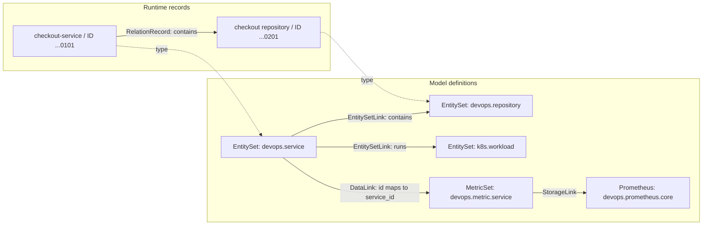

# Modeling and entity relationships

中文：[UModel 建模与实体关系](../../zh/guides/umodel-modeling-and-entity-relations.md)

UModel models object types, fields, data sources, and relationship semantics. Entity and relation records describe the actual objects. For the checkout service, `devops.service` is the type and `checkout-service` is one entity. Its `contains` relation to a source repository is a directed edge.

## How models and records fit together

A workspace holds a set of models, entities, and relations. Domains such as `devops` and `k8s` are semantic namespaces within that workspace. Entities in the same workspace can have relations across domains.

| What to describe | Model definition | Runtime or query behavior |
|---|---|---|
| Fields of an object type | `entity_set` | An `EntityRecord` holds one object's identity and properties. |
| A relationship between two object types | `entity_set_link` | A `RelationRecord` identifies the source entity, relation type, and destination entity. |
| An object's metrics, logs, or events | `metric_set`, `log_set`, `event_set`, and other datasets, with a `data_link` | Queries map entity fields to dataset labels or fields. |
| Where a dataset lives | A storage model and `storage_link` | Queries produce a plan for the downstream store. Storage model kinds include `prometheus` and `elasticsearch`. |
| Operational knowledge for an object | `runbook_set` with a `runbook_link` | Callers discover related Skill and Knowledge definitions. |

`Storage` is a model category. `--graphstore memory` or `file.memory` selects how UModel stores its own model and runtime graphs. A modeled Prometheus endpoint describes where metric data lives.



The shortened IDs in the diagram are display labels; writes and queries below use complete IDs. Importing an `EntitySetLink` saves the relationship definition. `topo write` supplies the actual edges. The local service does not automatically match entities or generate topology when a Link or `fields_mapping` is imported.

## Define an object type

A model file contains `kind`, `schema`, `metadata`, and `spec`. `metadata.domain` and `metadata.name` identify its semantic name, while `kind` identifies the element type. The model stable key is `domain/name/kind`, such as `devops/devops.service/entity_set`.

This reduced version of the [service model](../../../examples/quickstart-multidomain/umodel/devops/entity_set/devops.service.yaml) keeps its identity and a few business fields. Store one model element per YAML or JSON import file.

```yaml
kind: entity_set
schema:
  url: "umodel.aliyun.com"
  version: "v0.1.0"
metadata:
  name: devops.service
  domain: devops
spec:
  fields:
    - name: id
      type: string
    - name: display_name
      type: string
    - name: owner
      type: string
    - name: environment
      type: string
  primary_key_fields: [id]
  id_generator: id
  name_fields: [display_name]
  first_observed_time_field: "__first_observed_time__"
  last_observed_time_field: "__last_observed_time__"
```

`fields` describes business properties; `primary_key_fields` and `id_generator` describe identity rules. The current EntityStore write API requires callers to provide `__entity_id__` and does not evaluate this ID generator expression. The sample sets the business field `id` equal to `__entity_id__` so it can also identify the service in metrics.

## Define relationships between entities

The [service-to-repository Link](../../../examples/quickstart-multidomain/umodel/devops/link/entity_set_link/devops.service_contains_devops.repository.yaml) defines the endpoint types and relation name:

```yaml
kind: entity_set_link
schema:
  url: "umodel.aliyun.com"
  version: "v0.1.0"
metadata:
  name: devops.service_contains_devops.repository
  domain: devops
spec:
  src:
    domain: devops
    kind: entity_set
    name: devops.service
  dest:
    domain: devops
    kind: entity_set
    name: devops.repository
  entity_link_type: contains
```

`src` and `dest` refer to models; instance IDs do not appear in this definition. `spec.entity_link_type` supplies the relation semantics. `metadata.name` identifies the Link itself.

A `contains` edge from a service to a repository and an edge in the reverse direction are distinct relations. Multiple edges can represent one-to-many or many-to-many relationships; the current write API does not enforce cardinality constraints such as one-to-one. The same source entity, relation type, and destination entity share one relation stable key. Writing that key with `Update` updates the edge.

Cross-domain relations still belong to one workspace. For example, the [service-to-workload Link](../../../examples/quickstart-multidomain/umodel/cross-domain/link/entity_set_link/devops.service_runs_k8s.workload.yaml) has source type `devops/devops.service`, destination type `k8s/k8s.workload`, and relation type `runs`. Its `metadata.domain` is `devops`; the endpoints can have different domains.

## Connect metrics and storage

Four model elements define the checkout metric path:

| Element | Sample file | Purpose |
|---|---|---|
| MetricSet | [devops.metric.service](../../../examples/quickstart-multidomain/umodel/devops/metric_set/devops.metric.service.yaml) | Defines `service_id` and `environment` labels and generator expressions for metrics such as `request_count`. |
| DataLink | [Service metrics link](../../../examples/quickstart-multidomain/umodel/devops/link/data_link/devops.service_related_to_devops.metric.service.yaml) | Maps the entity field `id` to the dataset label `service_id`. |
| StorageLink | [Metric storage link](../../../examples/quickstart-multidomain/umodel/devops/link/storage_link/devops.metric.service_to_prometheus.yaml) | Maps dataset fields to storage fields and refers to the Prometheus model. |
| Prometheus | [devops.prometheus.core](../../../examples/quickstart-multidomain/umodel/devops/storage/devops.prometheus.core.yaml) | Configures the endpoint, API prefix, query step, and other storage settings. |

A complete DataLink definition is:

```yaml
kind: data_link
schema:
  url: "umodel.aliyun.com"
  version: "v1.0.0"
metadata:
  name: devops.service_related_to_devops.metric.service
  domain: devops
spec:
  src:
    domain: devops
    kind: entity_set
    name: devops.service
  dest:
    domain: devops
    kind: metric_set
    name: devops.metric.service
  fields_mapping:
    id: service_id
    environment: environment
  data_link_type: related_to
```

Mappings run from source field to destination field. Here, DataLink maps `id` to `service_id`, and StorageLink keeps `service_id` as the Prometheus label name. The environment field also has a mapping. A query that passes only `ids` does not automatically load the entity's `environment` property; supply additional constraints through the query or entity context in the request.

`data_link` and `storage_link` participate in query planning. They do not require one `RelationRecord` per entity. RunbookSet uses `runbook_link`; `list_skills()` and `list_knowledge()` return definitions, while the caller handles their use and any tool execution.

## Required record fields

An entity stable key is `domain/entity_type/entity_id`. A relation stable key joins the source entity stable key, relation type, and destination entity stable key. The API path or CLI argument selects the workspace; the workspace is not part of these keys.

`__entity_id__` and both relation endpoint IDs must contain 32 lowercase hexadecimal characters. `__first_observed_time__` and `__last_observed_time__` use Unix seconds. This excerpt from the checkout [entity sample](../../../examples/quickstart-multidomain/sample-data/entities.json) retains all required write fields:

```json
{
  "__domain__": "devops",
  "__entity_type__": "devops.service",
  "__entity_id__": "10000000000000000000000000000101",
  "__category__": "entity",
  "__method__": "Update",
  "__first_observed_time__": 1704067200,
  "__last_observed_time__": 4102444800,
  "__keep_alive_seconds__": 3600,
  "id": "10000000000000000000000000000101",
  "display_name": "checkout-service",
  "owner": "commerce-engineering",
  "environment": "prod"
}
```

The service-to-repository edge in the [relation sample](../../../examples/quickstart-multidomain/sample-data/relations.json) is:

```json
{
  "__src_domain__": "devops",
  "__src_entity_type__": "devops.service",
  "__src_entity_id__": "10000000000000000000000000000101",
  "__dest_domain__": "devops",
  "__dest_entity_type__": "devops.repository",
  "__dest_entity_id__": "10000000000000000000000000000201",
  "__relation_type__": "contains",
  "__category__": "entity_link",
  "__method__": "Update",
  "__first_observed_time__": 1704067200,
  "__last_observed_time__": 4102444800,
  "__keep_alive_seconds__": 3600,
  "display_name": "checkout-service source repository"
}
```

The sample uses fixed times for repeatable queries. Collectors should supply actual observation times. `__category__` and `__keep_alive_seconds__` appear in these records, but the current base payload validator does not require them.

Model import validates each model's `spec`. Runtime writes validate reserved fields, ID format, and `__method__`. They do not check every business property against EntitySet field types or enforce existing endpoints and a matching EntitySetLink. Collectors should import models first, then write entities and relations with consistent types and fields. See [Source entry points and call paths](#source-entry-points-and-call-paths) for the code.

## Import and query the sample

Run commands from the repository root. Go 1.22 or newer is required; the Web UI started by `make quickstart` also needs Node.js 22 or newer. See [Quick start](../getting-started/quickstart.md) for the full environment requirements.

### Start the service and import models

```bash
make quickstart
```

The defaults are `GRAPHSTORE=memory`, `QUICKSTART_WORKSPACE=demo`, and `QUICKSTART_SAMPLE=multi-domain-quickstart`. The API listens at `http://localhost:8080` and the Web UI at `http://localhost:5173`.

For an API-only session, run this instead in a terminal:

```bash
go run ./cmd/umodel-server --quickstart --graphstore memory
```

Use a separate `modeling-lab` workspace for writes and expiration:

```bash
go run ./cmd/umctl --addr http://localhost:8080 workspace create modeling-lab '{"name":"Modeling lab"}'
go run ./cmd/umctl --addr http://localhost:8080 umodel import modeling-lab --path examples/quickstart-multidomain/umodel
```

The server reads `--path`, which must be inside its allowed import root, normally its working directory. This imports models from `umodel/`; the next step writes entities and relations separately.

### Write entities and relations

```bash
go run ./cmd/umctl --addr http://localhost:8080 entity write modeling-lab --file examples/quickstart-multidomain/sample-data/entities.json
go run ./cmd/umctl --addr http://localhost:8080 topo write modeling-lab --file examples/quickstart-multidomain/sample-data/relations.json
```

The current sample has 89 models, 93 entities, and 125 relations. The import result should report `imported: 89`. The two writes should report `accepted: 93` and `accepted: 125`, both with `failed: 0`. Each write result's `items[].id` contains a stable key suitable for expiration.

The CLI accepts a single JSON record, an array, or a batch object and wraps arrays automatically. Direct REST requests need `{"entities":[...]}` or `{"relations":[...]}`.

### Query models and entities

```bash
go run ./cmd/umctl --addr http://localhost:8080 query run modeling-lab \
  ".umodel with(kind='entity_set', domain='devops', name='devops.service') | project domain,name,kind,spec"

go run ./cmd/umctl --addr http://localhost:8080 query run modeling-lab \
  ".entity with(domain='devops', name='devops.service', ids=['10000000000000000000000000000101']) | project __entity_id__,display_name,owner,environment"
```

The first query returns the service type and its `spec`. The second returns one row with `display_name` equal to `checkout-service`, `owner` equal to `commerce-engineering`, and `environment` equal to `prod`.

### Query entity relations

Read checkout's direct relations, including incoming and outgoing edges:

```bash
go run ./cmd/umctl --addr http://localhost:8080 query run modeling-lab \
  ".topo | graph-call getDirectRelations([(:\"devops@devops.service\" {__entity_id__: '10000000000000000000000000000101'})]) | project src,relation,dest | limit 20"
```

Read only edges that start at checkout:

```bash
go run ./cmd/umctl --addr http://localhost:8080 query run modeling-lab \
  ".topo with(src='devops/devops.service/10000000000000000000000000000101') | project src,relation,dest | limit 20"
```

The current sample returns four outgoing edges:

| Relation | Destination entity type | Destination ID |
|---|---|---|
| `contains` | `devops.repository` | `10000000000000000000000000000201` |
| `measured_by` | `devops.slo` | `10000000000000000000000000000901` |
| `runs` | `k8s.workload` | `20000000000000000000000000000201` |
| `runs_in` | `devops.environment` | `10000000000000000000000000000401` |

Use controlled read-only Cypher to inspect any five edges and their endpoint properties:

```bash
go run ./cmd/umctl --addr http://localhost:8080 query run modeling-lab \
  '.topo | graph-call cypher(`MATCH (src)-[r]->(dest) RETURN src, r AS relation, dest LIMIT 5`)'
```

The shell's outer single quotes keep the Cypher backticks from triggering command substitution.

### Discover datasets and generate a metric query plan

```bash
go run ./cmd/umctl --addr http://localhost:8080 query run modeling-lab \
  ".entity_set with(domain='devops', name='devops.service') | entity-call list_data_set(['metric_set', 'log_set', 'event_set'], true)"

go run ./cmd/umctl --addr http://localhost:8080 query run modeling-lab \
  ".entity_set with(domain='devops', name='devops.service', ids=['10000000000000000000000000000101']) | entity-call get_metrics('devops', 'devops.metric.service', 'request_count', step='30s')"
```

The first query lists the service's metric, log, and event datasets. With the default response format, the second returns `responseType=1` and a JSON-encoded plan in `query`. The plan includes `mode: "plan"`, the Prometheus endpoint, and step `30s`. Its PromQL is:

```promql
sum(rate(devops_service_request_total{service_id="10000000000000000000000000000101"}[1m]))
```

UModel maps fields and generates this query without connecting to Prometheus. The caller must execute the planned query to obtain time-series data. The sample's `http://localhost:9090` is a storage setting; starting UModel does not start that metric service.

The default quickstart pack has no RunbookSet. Calling `list_skills()` on it returns an empty table. Use the [incident investigation example](../../../examples/incident-investigation/README.md) for Skills and Knowledge.

### Use REST or inspect a query plan

```bash
curl --fail-with-body -sS http://localhost:8080/api/v1/query/modeling-lab/execute \
  -H 'Content-Type: application/json' \
  --data-binary @- <<'JSON'
{
  "query": ".entity with(domain='devops', name='devops.service', ids=['10000000000000000000000000000101']) | project __entity_id__,display_name"
}
JSON

go run ./cmd/umctl --addr http://localhost:8080 query explain modeling-lab \
  ".entity with(domain='devops', name='devops.service') | limit 5"
```

The default REST query response puts column names in `data.header` and row-value arrays in `data.data`. `explain` returns the source, provider, and operator plan. MCP clients can use the same SPL through `query_spl_execute`; see the [MCP reference](../reference/mcp.md).

## Update, expire, and restore records

These behaviors apply to the `memory` provider used here:

| Operation | Behavior |
|---|---|
| `__method__: "Create"` | Creates a record; fails if the same key exists and is not marked deleted. |
| `__method__: "Update"` | Creates a missing record or replaces an existing payload, preserving its original `__first_observed_time__`. Include every business field that should remain. |
| `__method__: "Expire"` | Retains the record and marks it invisible to default queries. Time-range queries can read expired records whose visibility overlaps the requested range. |
| `__method__: "Delete"` | Marks the record deleted; queries also exclude its historical visibility. |

Expire the service-to-repository edge, then the repository entity:

```bash
go run ./cmd/umctl --addr http://localhost:8080 topo expire modeling-lab \
  --ids 'devops/devops.service/10000000000000000000000000000101/contains/devops/devops.repository/10000000000000000000000000000201'

go run ./cmd/umctl --addr http://localhost:8080 entity expire modeling-lab \
  --ids 'devops/devops.repository/10000000000000000000000000000201'
```

Query checkout's outgoing edges again; the `contains` edge should be absent. Expiring an entity does not cascade to other relations. The repository-to-pipeline `exec` edge in this example still needs separate handling if it should also expire.

The CLI's `entity delete` and `topo delete` currently call the same `:expire` endpoints. To use the payload's `Delete` behavior, submit a record through `entity write` or `topo write` with the required fields and `__method__` set to `Delete`.

Repeat the two sample write commands to restore the entities and relations from this exercise. `memory` discards graph data when the process exits; use [file.memory](../graphstore-providers.md) for persistence. Stop services launched by `make quickstart` with `make stop-all`, or stop the foreground `go run` server with Ctrl+C.

## Source entry points and call paths

| Source | Behavior |
|---|---|
| [pkg/model/types.go](../../../pkg/model/types.go) | Defines models, entities, relations, and batches; `UModelElementKey`, `EntityStableKey`, and `RelationStableKey` generate stable keys. |
| [internal/umodel/import.go](../../../internal/umodel/import.go) | Confines import paths, normalizes each YAML/JSON file into one `UModelElement`, and skips directories such as `sample-data`. |
| [internal/umodel/service.go](../../../internal/umodel/service.go) | `PutElements` validates and stores models; `ValidateEntityPayload` and `ValidateRelationPayload` perform base runtime validation. |
| [internal/entitystore/service.go](../../../internal/entitystore/service.go) | Handles entity and relation writes and expiration, in-process idempotency caching, and partial-success results. |
| [internal/graphstore/memory.go](../../../internal/graphstore/memory.go) | Stores records by workspace and implements updates, expiration, and query visibility. |
| [internal/query/executor.go](../../../internal/query/executor.go) | Reads models, entities, and topology and follows DataLink and StorageLink to generate metric or log query plans. |

Model imports pass through `Import`, `PutElements`, and `GraphStore.PutUModelElements`, then update the schema and search indexes. The model stable key excludes `version`, so writing the same key replaces its current definition. Model schema validation checks `spec` structure without verifying every Link reference in the workspace.

EntityStore performs base validation before submitting entity and relation writes to GraphStore. With `partial_success=false`, a base validation failure prevents submission. During provider writes, however, `memory` does not roll back earlier successes in the batch, so this flag does not promise a multi-record transaction.

Query Service passes queries through the [parser](../../../internal/query/parser.go) and [planner](../../../internal/query/planner.go), then executes the plan. `get_metrics` resolves DataLink, MetricSet, and the storage referenced by StorageLink before generating a downstream query. `get_logs` follows the corresponding log-planning path. Callers supply additional entity context through request fields such as `filterByEntities`.

`memory` stores the current payload for each key, without a complete history of every update. `RunTTL` currently has no cleanup implementation; queries without a time range do not automatically hide records after their keep-alive time has passed. Collectors should expire records explicitly or use time-range queries as needed.

## Troubleshooting

| Symptom | What to check |
|---|---|
| Models are imported but `.entity` is empty | Models and instances have separate writes. Check the workspace and entity write result. |
| A Link exists but `.topo` has no edge | Check that the relation was written, its endpoints and type match, and its lifecycle state permits visibility. |
| A write returns `VALIDATION_FAILED` | Check for 32-character lowercase hex IDs, both observation times, and a valid `__method__`. |
| Expiration fails | Use the complete `items[].id` from a write result: three parts for an entity, seven for a relation. |
| Metric planning cannot find a dataset or storage | Check `domain/kind/name` references and `filter_by_entity` across DataLink, DataSet, StorageLink, and Storage. |
| Properties disappear after an update | `Update` replaces the payload. Include all fields that should remain. |

See the [schema reference](../reference/schema/index.md) for complete field definitions and [OpenAPI](../../../api/openapi/openapi.yaml) for public interfaces.
