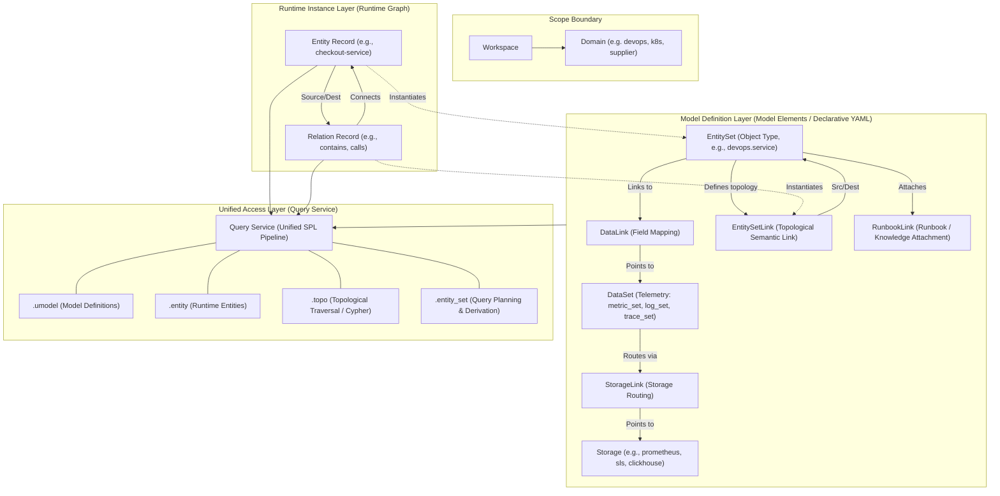

# UModel Modeling and Entity Relationships Guide

This document outlines the modeling methodology, core entity relationships, and common operational procedures and examples within UModel (Unified Model).

---

## 1. Modeling Philosophy and Architecture

UModel serves as a vendor-neutral semantic runtime for enterprise AI, data governance, and AIOps, organizing disparate schemas, entities, telemetry, and topology into a **workspace-scoped Object Graph Semantic Layer**.

The modeling system is divided into two distinct layers:
1. **Model Definition Layer (Model Elements / Schema)**: Declared via YAML files, defining object types, telemetry datasets, physical storage, and semantic links/mappings between them.
2. **Runtime Instance Layer (Runtime Graph Records)**: Concrete instances containing entity nodes and topological edges.



---

## 2. Core Entities and Relationships

| Classification | Model Element (Kind) | Responsibility | Relationships & Links |
|---|---|---|---|
| **Entity Type** | `entity_set` | Defines an operational or business object type and its schema fields (e.g., Service, Node, Pod). | Serves as endpoints for `DataLink`, `EntitySetLink`, and `RunbookLink`. |
| **Telemetry Dataset** | `metric_set`, `log_set`, `trace_set`, `event_set`, `profile_set`, `runbook_set` | Describes telemetry signals or knowledge attached to entities. Holds no runtime rows directly. | Bound to entities via `DataLink` and routed to storage via `StorageLink`. |
| **Data Link** | `data_link` | Establishes semantic mapping between an `EntitySet` and a `DataSet` using `fields_mapping`. | **Source:** `entity_set`<br>**Dest:** `DataSet` |
| **Storage Link** | `storage_link` | Routes a logical `DataSet` to physical storage components. | **Source:** `DataSet`<br>**Dest:** `Storage` |
| **Entity Relation Link**| `entity_set_link` | Defines directional relation types between two `EntitySet` definitions (e.g., `contains`, `calls`). | **Source:** `entity_set`<br>**Dest:** `entity_set` |
| **Runbook Link** | `runbook_link` | Connects remediation runbooks / SOP knowledge to an entity type. | **Source:** `entity_set`<br>**Dest:** `runbook_set` |
| **Runtime Records** | `EntityRecord` & `RelationRecord` | Concrete graph nodes and edges adhering to schemas. | Instantiated according to `EntitySet` and `EntitySetLink`. |

---

## 3. Declarative Modeling Example

Example depicting a DevOps service linked to metric datasets and source code repositories:

### (1) Entity Definition: `devops.service` (EntitySet)
```yaml
kind: entity_set
schema:
  url: "umodel.aliyun.com"
  version: "v0.1.0"
metadata:
  name: "devops.service"
  domain: "devops"
  display_name:
    en_us: "Service"
spec:
  fields:
    - name: id
      type: string
    - name: display_name
      type: string
    - name: owner
      type: string
    - name: environment
      type: string
```

### (2) Topology Relation Definition: Service contains Repository (EntitySetLink)
```yaml
kind: entity_set_link
schema:
  url: "umodel.aliyun.com"
  version: "v0.1.0"
metadata:
  name: "devops.service_contains_devops.repository"
  domain: "devops"
spec:
  src:
    domain: devops
    kind: entity_set
    name: devops.service
  dest:
    domain: devops
    kind: entity_set
    name: devops.repository
  entity_link_type: contains
```

### (3) Telemetry & Field Mapping: MetricSet & DataLink
```yaml
kind: data_link
schema:
  url: "umodel.aliyun.com"
  version: "v1.0.0"
metadata:
  name: "devops.service_related_to_devops.metric.service"
  domain: "devops"
spec:
  src:
    domain: devops
    kind: entity_set
    name: devops.service
  dest:
    domain: devops
    kind: metric_set
    name: devops.metric.service
  data_link_type: related_to
  fields_mapping:
    id: service_id
```

---

## 4. Operational Commands & Query Examples

### (1) Workspace Setup & Model Import
```bash
# Create Workspace
go run ./cmd/umctl --addr http://localhost:8080 workspace create demo '{"name":"Demo Workspace"}'

# Import Model Package
go run ./cmd/umctl --addr http://localhost:8080 umodel import demo examples/quickstart-multidomain
```

### (2) Ingesting Runtime Entities & Relations
```bash
# Ingest Entities
go run ./cmd/umctl --addr http://localhost:8080 entity write demo examples/quickstart-multidomain/sample-data/entities.json

# Ingest Relations
go run ./cmd/umctl --addr http://localhost:8080 topo write demo examples/quickstart-multidomain/sample-data/relations.json
```

### (3) Unified Query Service (SPL)
```bash
# Query Model Definitions
go run ./cmd/umctl --addr http://localhost:8080 query run demo \
  ".umodel with(kind='entity_set') | sort name | limit 20"

# Query Runtime Entities
go run ./cmd/umctl --addr http://localhost:8080 query run demo \
  ".entity with(domain='devops', name='devops.service', query='checkout') | project __entity_id__,display_name | limit 10"

# Topological Traversal
go run ./cmd/umctl --addr http://localhost:8080 query run demo \
  ".topo | graph-call getDirectRelations([(:\"devops@devops.service\" {__entity_id__: '10000000000000000000000000000101'})]) | limit 20"

# openCypher Query
go run ./cmd/umctl --addr http://localhost:8080 query run demo \
  ".topo | graph-call cypher(\`MATCH (src)-[r]->(dest) RETURN src, r AS relation, dest LIMIT 20\`)"

# Telemetry Query Plan Derivation via EntitySet
go run ./cmd/umctl --addr http://localhost:8080 query run demo \
  ".entity_set with(domain='devops', name='devops.service', ids=['10000000000000000000000000000101']) | entity-call get_metrics('devops', 'devops.metric.service', 'request_count', step='30s')"
```
