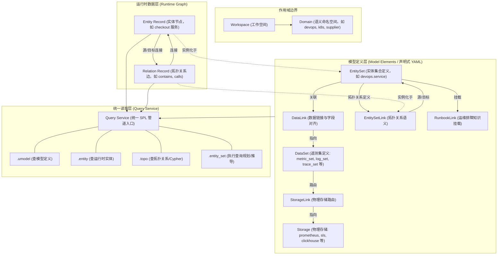

# UModel 建模体系与实体关系实战指南

本文档全面梳理 UModel（Unified Model）的建模理论体系、核心实体与元素间的网状拓扑及映射关系，并提供完整的端到端生命周期操作与实战示例。

---

## 一、 UModel 建模思想与架构分层

UModel 作为厂商中立的企业语义运行时，其核心目标是为 AI Agent、数据治理和智能运维提供一致的**对象图语义层 (Object Graph Semantic Layer)**。

UModel 的建模体系在逻辑上解耦为两层：
1. **模型定义层 (Model Elements / Schema)**：通过声明式 YAML 定义元数据，描述“有哪些实体类型”、“有哪些指标/日志遥测数据集”、“物理存储位置”，以及“实体与遥测、实体与实体之间的关联与映射关系”。
2. **运行时实例层 (Runtime Records)**：运行时的具体实例数据，包括实体记录（图节点，如某个具体的微服务实例）与拓扑记录（图边，如调用关系或包含关系）。



---

## 二、 核心实体与元素的关系

| 元素分类 | 模型元素 (Kind) | 核心职责 | 关系与连接 |
|---|---|---|---|
| **实体类型** | `entity_set` | 定义一类业务或运维对象类型及其属性字段（如服务、节点、工单）。 | 作为 `DataLink`、`EntitySetLink` 和 `RunbookLink` 的源/目标端。 |
| **遥测数据集** | `metric_set`, `log_set`, `trace_set`, `event_set`, `profile_set`, `runbook_set` | 描述附着在实体上的指标、日志、链路或排障知识的结构，本身不存数据。 | 由 `DataLink` 与实体绑定，由 `StorageLink` 路由到具体存储。 |
| **数据链接** | `data_link` | 建立 `EntitySet` 与 `DataSet` 之间的语义绑定，并通过 `fields_mapping` 进行字段对齐。 | **Source:** `entity_set`<br>**Dest:** `DataSet` |
| **存储链接** | `storage_link` | 将 `DataSet` 逻辑定义绑定到真实的物理存储组件上。 | **Source:** `DataSet`<br>**Dest:** `Storage` |
| **实体间拓扑链接** | `entity_set_link` | 定义两个 `EntitySet` 之间的有向拓扑语义类型（如 `contains`、`calls`、`runs_on`）。 | **Source:** `entity_set`<br>**Dest:** `entity_set` |
| **知识/SOP链接** | `runbook_link` | 将排障手册（RunbookSet）关联到实体类型，供 AI Agent 排障。 | **Source:** `entity_set`<br>**Dest:** `runbook_set` |
| **运行时记录** | `EntityRecord` 与 `RelationRecord` | 具体的节点与边，承载运行时真实的拓扑和属性。 | 严格遵循 `EntitySet` 与 `EntitySetLink` 的 Schema 定义。 |

---

## 三、 声明式建模配置示例

以下以典型的 DevOps 场景为例：定义一个**微服务实体**、一个**服务指标集**、一个**物理 Prometheus 存储**以及它们之间的关联。

### 1. 实体定义：`devops.service` (EntitySet)
```yaml
kind: entity_set
schema:
  url: "umodel.aliyun.com"
  version: "v0.1.0"
metadata:
  name: "devops.service"
  domain: "devops"
  display_name:
    zh_cn: "服务"
    en_us: "Service"
spec:
  fields:
    - name: id
      type: string
      description: "实体稳定主键标识"
    - name: display_name
      type: string
    - name: owner
      type: string
    - name: environment
      type: string
```

### 2. 拓扑关系定义：服务包含代码仓库 (EntitySetLink)
```yaml
kind: entity_set_link
schema:
  url: "umodel.aliyun.com"
  version: "v0.1.0"
metadata:
  name: "devops.service_contains_devops.repository"
  domain: "devops"
spec:
  src:
    domain: devops
    kind: entity_set
    name: devops.service
  dest:
    domain: devops
    kind: entity_set
    name: devops.repository
  entity_link_type: contains
```

### 3. 数据集与映射定义：服务关联监控指标 (MetricSet + DataLink)
```yaml
# 1. 定义指标集 (MetricSet)
kind: metric_set
schema:
  url: "umodel.aliyun.com"
  version: "v1.0.0"
metadata:
  name: "devops.metric.service"
  domain: "devops"
spec:
  labels:
    keys:
      - name: service_id
        type: string
  metrics:
    - name: request_count
      aggregator: sum
    - name: error_count
      aggregator: sum

---
# 2. 通过 DataLink 将服务实体与指标集连接并映射字段
kind: data_link
schema:
  url: "umodel.aliyun.com"
  version: "v1.0.0"
metadata:
  name: "devops.service_related_to_devops.metric.service"
  domain: "devops"
spec:
  src:
    domain: devops
    kind: entity_set
    name: devops.service
  dest:
    domain: devops
    kind: metric_set
    name: devops.metric.service
  data_link_type: related_to
  fields_mapping:
    id: service_id                  # 实体字段 id 自动映射为指标的 service_id 标签
```

---

## 四、 核心生命周期操作与实操示例

UModel 遵循清晰的研发和运维操作生命周期：
1. **创建工作空间并导入模型包**
2. **写入/同步运行时实体与关系**
3. **通过 SPL (Query Service) 执行统一查询与推理**

### 1. 工作空间与模型导入

```bash
# 创建独立的工作空间
go run ./cmd/umctl --addr http://localhost:8080 workspace create demo '{"name":"Demo Workspace"}'

# 导入声明式模型定义包（包含多领域 schema 定义）
go run ./cmd/umctl --addr http://localhost:8080 umodel import demo examples/quickstart-multidomain
```

### 2. 运行时数据写入

#### (1) 写入实体记录 (Entity Write)
实体写入需指定三元组定位：`__domain__`、`__entity_type__`、`__entity_id__`。
```json
[
  {
    "__domain__": "devops",
    "__entity_type__": "devops.service",
    "__entity_id__": "10000000000000000000000000000101",
    "__category__": "entity",
    "__method__": "Update",
    "id": "10000000000000000000000000000101",
    "display_name": "checkout-service",
    "owner": "commerce-team",
    "environment": "production"
  }
]
```
```bash
go run ./cmd/umctl --addr http://localhost:8080 entity write demo examples/quickstart-multidomain/sample-data/entities.json
```

#### (2) 写入拓扑关系 (Relation Write)
指定源实体、目标实体以及关系类型：
```json
[
  {
    "__relation_type__": "contains",
    "__src_domain__": "devops",
    "__src_entity_type__": "devops.service",
    "__src_entity_id__": "10000000000000000000000000000101",
    "__dest_domain__": "devops",
    "__dest_entity_type__": "devops.repository",
    "__dest_entity_id__": "10000000000000000000000000000201",
    "__category__": "relation",
    "__method__": "Update"
  }
]
```
```bash
go run ./cmd/umctl --addr http://localhost:8080 topo write demo examples/quickstart-multidomain/sample-data/relations.json
```

---

### 3. 统一 SPL 查询操作

UModel 通过统一的 Query Service 承载所有数据检索，杜绝分散的专用读接口。

#### (1) 检索模型定义 (`.umodel`)
```bash
# 查询当前工作空间的所有 EntitySet 定义
go run ./cmd/umctl --addr http://localhost:8080 query run demo \
  ".umodel with(kind='entity_set') | sort name | limit 20"
```

#### (2) 检索运行时实体 (`.entity`)
```bash
# 按领域和名称过滤，模糊查询 checkout 并投影指定字段
go run ./cmd/umctl --addr http://localhost:8080 query run demo \
  ".entity with(domain='devops', name='devops.service', query='checkout') | project __entity_id__,display_name,owner | limit 10"
```

#### (3) 拓扑遍历与 Cypher 语法 (`.topo`)
```bash
# 1. 查找指定实体的直接关联关系 (getDirectRelations)
go run ./cmd/umctl --addr http://localhost:8080 query run demo \
  ".topo | graph-call getDirectRelations([(:\"devops@devops.service\" {__entity_id__: '10000000000000000000000000000101'})]) | limit 20"

# 2. 执行受控 openCypher 遍历语句
go run ./cmd/umctl --addr http://localhost:8080 query run demo \
  ".topo | graph-call cypher(\`MATCH (src)-[r]->(dest) RETURN src, r AS relation, dest LIMIT 20\`)"
```

#### (4) 实体方法与自动查询规划推导 (`.entity_set`)
针对实体上下文自动生成下游遥测系统的查询规划，AI Agent 无需了解复杂的底层 Prometheus 或 ES 语法：
```bash
# 基于 DataLink 自动推导该服务的 Prometheus 指标查询计划
go run ./cmd/umctl --addr http://localhost:8080 query run demo \
  ".entity_set with(domain='devops', name='devops.service', ids=['10000000000000000000000000000101']) | entity-call get_metrics('devops', 'devops.metric.service', 'request_count', step='30s')"

# 发现实体绑定的排障技能 (Skills) 与专家经验 (Knowledge)
go run ./cmd/umctl --addr http://localhost:8080 query run demo \
  ".entity_set with(domain='devops', name='devops.service') | entity-call list_skills()"
```

---

## 五、 最佳实践与设计守则

1. **元数据先于实例数据**：始终先执行 `umodel import` 导入 Schema 与 Link，再执行 `entity write` 和 `topo write` 写入实例数据，确保图的自洽性。
2. **使用稳定的实体标识符**：`__entity_id__` 必须保持全局或域内稳定，避免将容易变更的名称作为图节点的唯一键。
3. **保持读取接口收敛**：所有外部客户端（Web UI、CLI、REST API、MCP、Agent）均收敛至 Query Service 管道，通过 `.umodel`、`.entity`、`.topo` 和 `.entity_set` 统一访问。
