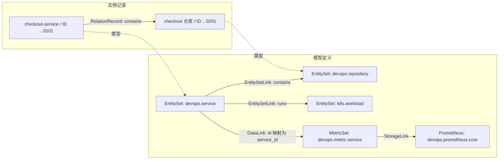

# UModel 建模与实体关系

English: [Modeling and entity relationships](../../en/guides/umodel-modeling-and-entity-relations.md)

UModel 用模型描述对象类型、字段、数据来源和关系语义，再用实体记录与关系记录表示具体对象。以 checkout 服务为例，`devops.service` 是类型，`checkout-service` 是一个实体；服务与代码仓库之间的 `contains` 则是一条有方向的关系。

## 模型与实例如何对应

一个 workspace 保存一组模型、实体和关系。`devops`、`k8s` 等 domain 是 workspace 内的语义命名空间。同一 workspace 中的实体可以跨 domain 建立关系。

| 要表达的内容 | 模型定义 | 运行时或查询时的含义 |
|---|---|---|
| 一类对象有哪些字段 | `entity_set` | `EntityRecord` 保存某个对象的身份和属性。 |
| 哪两类对象之间有什么关系 | `entity_set_link` | `RelationRecord` 指定源实体、关系类型和目标实体。 |
| 对象有哪些指标、日志或事件 | `metric_set`、`log_set`、`event_set` 等，加上 `data_link` | 查询时把实体字段映射到数据集的标签或字段。 |
| 数据集存在哪里 | 存储类型模型，加上 `storage_link` | 生成下游存储的查询计划。存储模型的 `kind` 可以是 `prometheus`、`elasticsearch` 等。 |
| 对象有哪些操作知识 | `runbook_set` 加上 `runbook_link` | 发现关联的 Skills 和 Knowledge 定义。 |

`Storage` 是模型类别。`--graphstore memory` 或 `file.memory` 选择的是 UModel 自身模型图和实例图的保存方式；模型中的 Prometheus endpoint 则描述指标数据的位置。



图中的短 ID 仅用于显示；写入和查询使用后文的完整 ID。导入 `EntitySetLink` 会保存关系定义，具体的实例边由 `topo write` 写入。当前本地服务不会因为导入了 Link 或配置了 `fields_mapping` 就自动匹配实体、生成拓扑。

## 定义对象类型

模型文件包含 `kind`、`schema`、`metadata` 和 `spec`。`metadata.domain` 和 `metadata.name` 标识语义名称，`kind` 标识元素类型。模型稳定键为 `domain/name/kind`，例如 `devops/devops.service/entity_set`。

以下是 [服务模型](../../../examples/quickstart-multidomain/umodel/devops/entity_set/devops.service.yaml) 的简化版本。导入文件时，每个 YAML 或 JSON 文件放一个模型元素。

```yaml
kind: entity_set
schema:
  url: "umodel.aliyun.com"
  version: "v0.1.0"
metadata:
  name: devops.service
  domain: devops
spec:
  fields:
    - name: id
      type: string
    - name: display_name
      type: string
    - name: owner
      type: string
    - name: environment
      type: string
  primary_key_fields: [id]
  id_generator: id
  name_fields: [display_name]
  first_observed_time_field: "__first_observed_time__"
  last_observed_time_field: "__last_observed_time__"
```

`fields` 描述业务属性，`primary_key_fields` 和 `id_generator` 描述身份规则。当前 EntityStore 写入接口要求调用方提供 `__entity_id__`，不会执行这里的 ID 生成表达式。样例把业务字段 `id` 与 `__entity_id__` 设为相同值，便于关联指标。

## 定义实体之间的关系

[服务与仓库的 Link](../../../examples/quickstart-multidomain/umodel/devops/link/entity_set_link/devops.service_contains_devops.repository.yaml) 指定两端类型和关系名称：

```yaml
kind: entity_set_link
schema:
  url: "umodel.aliyun.com"
  version: "v0.1.0"
metadata:
  name: devops.service_contains_devops.repository
  domain: devops
spec:
  src:
    domain: devops
    kind: entity_set
    name: devops.service
  dest:
    domain: devops
    kind: entity_set
    name: devops.repository
  entity_link_type: contains
```

`src` 和 `dest` 引用模型，实例 ID 不出现在这个定义中。关系语义取自 `spec.entity_link_type`；`metadata.name` 用于标识这个 Link。

实例中从服务指向仓库的 `contains` 与反向边是两条不同的关系。多条边可以表达一对多或多对多；当前写入接口不检查一对一等基数约束。同一源实体、同一关系类型、同一目标实体共享一个关系稳定键，再次以 `Update` 写入会更新该边。

跨域关系仍然位于一个 workspace 内。例如 [服务运行工作负载](../../../examples/quickstart-multidomain/umodel/cross-domain/link/entity_set_link/devops.service_runs_k8s.workload.yaml) 的源类型为 `devops/devops.service`，目标类型为 `k8s/k8s.workload`，关系类型为 `runs`。Link 的 `metadata.domain` 为 `devops`，并不要求两端 domain 相同。

## 连接指标与存储

checkout 的指标链由四个模型元素组成：

| 元素 | 样例文件 | 作用 |
|---|---|---|
| MetricSet | [devops.metric.service](../../../examples/quickstart-multidomain/umodel/devops/metric_set/devops.metric.service.yaml) | 定义 `service_id`、`environment` 标签，以及 `request_count` 等指标的生成表达式。 |
| DataLink | [服务关联指标](../../../examples/quickstart-multidomain/umodel/devops/link/data_link/devops.service_related_to_devops.metric.service.yaml) | 把实体字段 `id` 映射为数据集标签 `service_id`。 |
| StorageLink | [指标关联 Prometheus](../../../examples/quickstart-multidomain/umodel/devops/link/storage_link/devops.metric.service_to_prometheus.yaml) | 把数据集字段映射为存储字段，并引用 Prometheus 模型。 |
| Prometheus | [devops.prometheus.core](../../../examples/quickstart-multidomain/umodel/devops/storage/devops.prometheus.core.yaml) | 配置 endpoint、API 前缀和查询步长等。 |

DataLink 的完整定义可以写成：

```yaml
kind: data_link
schema:
  url: "umodel.aliyun.com"
  version: "v1.0.0"
metadata:
  name: devops.service_related_to_devops.metric.service
  domain: devops
spec:
  src:
    domain: devops
    kind: entity_set
    name: devops.service
  dest:
    domain: devops
    kind: metric_set
    name: devops.metric.service
  fields_mapping:
    id: service_id
    environment: environment
  data_link_type: related_to
```

映射方向是源字段到目标字段。这个例子中，`id` 经过 DataLink 变为 `service_id`，再经 StorageLink 保持为 Prometheus 的 `service_id` 标签。环境字段也有映射；仅传 `ids` 的查询不会自动读取实体的 `environment` 属性，额外条件需要由查询或请求中的实体上下文提供。

`data_link` 和 `storage_link` 参与查询规划，不需要为每个实体写一条对应的 `RelationRecord`。RunbookSet 通过 `runbook_link` 关联；`list_skills()`、`list_knowledge()` 返回定义，执行知识内容或工具属于调用方的职责。

## 写入记录需要哪些字段

实体稳定键是 `domain/entity_type/entity_id`。关系稳定键由源实体稳定键、关系类型和目标实体稳定键组成。workspace 由 API 路径或 CLI 参数指定，不包含在这些键中。

`__entity_id__` 以及关系两端的实体 ID 必须是 32 个小写十六进制字符。`__first_observed_time__`、`__last_observed_time__` 使用 Unix 秒。以下是 [实体样例](../../../examples/quickstart-multidomain/sample-data/entities.json) 中 checkout 记录的字段节选，保留了写入所需字段：

```json
{
  "__domain__": "devops",
  "__entity_type__": "devops.service",
  "__entity_id__": "10000000000000000000000000000101",
  "__category__": "entity",
  "__method__": "Update",
  "__first_observed_time__": 1704067200,
  "__last_observed_time__": 4102444800,
  "__keep_alive_seconds__": 3600,
  "id": "10000000000000000000000000000101",
  "display_name": "checkout-service",
  "owner": "commerce-engineering",
  "environment": "prod"
}
```

[关系样例](../../../examples/quickstart-multidomain/sample-data/relations.json) 中的服务与仓库边：

```json
{
  "__src_domain__": "devops",
  "__src_entity_type__": "devops.service",
  "__src_entity_id__": "10000000000000000000000000000101",
  "__dest_domain__": "devops",
  "__dest_entity_type__": "devops.repository",
  "__dest_entity_id__": "10000000000000000000000000000201",
  "__relation_type__": "contains",
  "__category__": "entity_link",
  "__method__": "Update",
  "__first_observed_time__": 1704067200,
  "__last_observed_time__": 4102444800,
  "__keep_alive_seconds__": 3600,
  "display_name": "checkout-service source repository"
}
```

样例使用固定时间，便于重复查询。采集真实数据时应填写实际观测时间。`__category__` 和 `__keep_alive_seconds__` 出现在样例中，但当前基础 payload 校验没有将它们列为必填字段。

模型导入会校验模型的 `spec`。运行时写入校验保留字段、ID 格式和 `__method__`，不会逐项按 EntitySet 的业务字段检查数据类型，也不强制检查关系两端是否已写入、是否存在匹配的 EntitySetLink。采集方应先导入模型、再写实体和关系，并保持类型与字段一致。具体代码见 [源码入口与调用链](#源码入口与调用链)。

## 从导入到查询

在仓库根目录执行命令。需要 Go 1.22 或更新版本；`make quickstart` 的 Web UI 还需要 Node.js 22 或更新版本。完整环境要求见 [快速开始](../getting-started/quickstart.md)。

### 启动服务并导入模型

```bash
make quickstart
```

默认配置为 `GRAPHSTORE=memory`、`QUICKSTART_WORKSPACE=demo`、`QUICKSTART_SAMPLE=multi-domain-quickstart`。API 位于 `http://localhost:8080`，Web UI 位于 `http://localhost:5173`。

只需要 API 时，可以改为在一个终端运行：

```bash
go run ./cmd/umodel-server --quickstart --graphstore memory
```

使用独立的 `modeling-lab` workspace 练习写入和过期操作：

```bash
go run ./cmd/umctl --addr http://localhost:8080 workspace create modeling-lab '{"name":"Modeling lab"}'
go run ./cmd/umctl --addr http://localhost:8080 umodel import modeling-lab --path examples/quickstart-multidomain/umodel
```

`--path` 由服务端读取，路径须位于服务端允许的 import root 内，默认是服务端工作目录。这里导入 `umodel/` 目录中的模型，实体和关系在下一步单独写入。

### 写入实体和关系

```bash
go run ./cmd/umctl --addr http://localhost:8080 entity write modeling-lab --file examples/quickstart-multidomain/sample-data/entities.json
go run ./cmd/umctl --addr http://localhost:8080 topo write modeling-lab --file examples/quickstart-multidomain/sample-data/relations.json
```

当前样例包含 89 个模型、93 个实体和 125 条关系。导入结果的 `imported` 应为 `89`，两次写入的 `accepted` 分别为 `93`、`125`，`failed` 均为 `0`。写入结果的 `items[].id` 是后续过期操作可用的稳定键。

CLI 接受单条 JSON、JSON 数组或 batch 对象，并自动包装数组。直接调用 REST 时，请使用 `{"entities":[...]}` 或 `{"relations":[...]}`。

### 查询模型和实体

```bash
go run ./cmd/umctl --addr http://localhost:8080 query run modeling-lab \
  ".umodel with(kind='entity_set', domain='devops', name='devops.service') | project domain,name,kind,spec"

go run ./cmd/umctl --addr http://localhost:8080 query run modeling-lab \
  ".entity with(domain='devops', name='devops.service', ids=['10000000000000000000000000000101']) | project __entity_id__,display_name,owner,environment"
```

第一条返回服务类型及其 `spec`。第二条返回一行，`display_name` 为 `checkout-service`，`owner` 为 `commerce-engineering`，`environment` 为 `prod`。

### 查询实体关系

查询 checkout 的直接关系，包括入边和出边：

```bash
go run ./cmd/umctl --addr http://localhost:8080 query run modeling-lab \
  ".topo | graph-call getDirectRelations([(:\"devops@devops.service\" {__entity_id__: '10000000000000000000000000000101'})]) | project src,relation,dest | limit 20"
```

只查询从 checkout 出发的边：

```bash
go run ./cmd/umctl --addr http://localhost:8080 query run modeling-lab \
  ".topo with(src='devops/devops.service/10000000000000000000000000000101') | project src,relation,dest | limit 20"
```

当前样例返回四条出边：

| 关系 | 目标实体类型 | 目标 ID |
|---|---|---|
| `contains` | `devops.repository` | `10000000000000000000000000000201` |
| `measured_by` | `devops.slo` | `10000000000000000000000000000901` |
| `runs` | `k8s.workload` | `20000000000000000000000000000201` |
| `runs_in` | `devops.environment` | `10000000000000000000000000000401` |

查看图中任意五条边及其两端的属性，可以使用受控的只读 Cypher：

```bash
go run ./cmd/umctl --addr http://localhost:8080 query run modeling-lab \
  '.topo | graph-call cypher(`MATCH (src)-[r]->(dest) RETURN src, r AS relation, dest LIMIT 5`)'
```

外层 shell 使用单引号，避免把 Cypher 两侧的反引号当作命令替换。

### 发现数据集并生成指标查询计划

```bash
go run ./cmd/umctl --addr http://localhost:8080 query run modeling-lab \
  ".entity_set with(domain='devops', name='devops.service') | entity-call list_data_set(['metric_set', 'log_set', 'event_set'], true)"

go run ./cmd/umctl --addr http://localhost:8080 query run modeling-lab \
  ".entity_set with(domain='devops', name='devops.service', ids=['10000000000000000000000000000101']) | entity-call get_metrics('devops', 'devops.metric.service', 'request_count', step='30s')"
```

第一条列出服务的指标、日志和事件数据集。第二条在默认响应中返回 `responseType=1`，`query` 字段是 JSON 编码的查询计划，包含 `mode: "plan"`、Prometheus endpoint 和步长 `30s`。其中的 PromQL 为：

```promql
sum(rate(devops_service_request_total{service_id="10000000000000000000000000000101"}[1m]))
```

UModel 在这里完成字段映射与查询生成，不连接 Prometheus 读取指标。取得实际时序数据需要调用方执行计划中的查询。样例中的 `http://localhost:9090` 是存储配置，启动 UModel 不会同时启动这个指标服务。

默认 quickstart 包没有 RunbookSet。对它调用 `list_skills()` 会返回空表；需要技能与知识示例时，可使用 [故障排查示例](../../../examples/incident-investigation/README.zh-CN.md)。

### 使用 REST 或检查查询计划

```bash
curl --fail-with-body -sS http://localhost:8080/api/v1/query/modeling-lab/execute \
  -H 'Content-Type: application/json' \
  --data-binary @- <<'JSON'
{
  "query": ".entity with(domain='devops', name='devops.service', ids=['10000000000000000000000000000101']) | project __entity_id__,display_name"
}
JSON

go run ./cmd/umctl --addr http://localhost:8080 query explain modeling-lab \
  ".entity with(domain='devops', name='devops.service') | limit 5"
```

REST 查询默认在 `data.header` 中返回列名，在 `data.data` 中返回对应的行值数组。`explain` 返回 source、provider 和操作计划。MCP 客户端可通过 `query_spl_execute` 使用同样的 SPL，见 [MCP 参考](../reference/mcp.md)。

## 更新、过期与恢复

以下行为以本例的 `memory` provider 为准：

| 操作 | 行为 |
|---|---|
| `__method__: "Create"` | 创建记录；同键且未标记删除的记录已存在时失败。 |
| `__method__: "Update"` | 不存在时创建，存在时替换 payload，保留原 `__first_observed_time__`。更新时需带上要保留的业务字段。 |
| `__method__: "Expire"` | 保留记录、标记不可见；默认查询不再返回该记录，时间范围查询可读取与范围重叠的过期记录。 |
| `__method__: "Delete"` | 标记删除；查询也会排除该记录的历史可见性。 |

先过期服务与仓库之间的边，再过期仓库实体：

```bash
go run ./cmd/umctl --addr http://localhost:8080 topo expire modeling-lab \
  --ids 'devops/devops.service/10000000000000000000000000000101/contains/devops/devops.repository/10000000000000000000000000000201'

go run ./cmd/umctl --addr http://localhost:8080 entity expire modeling-lab \
  --ids 'devops/devops.repository/10000000000000000000000000000201'
```

再次查询 checkout 的出边，`contains` 这条边应消失。实体过期不会级联过期其他关联边；本例中仓库到流水线的 `exec` 边仍需按业务需要单独处理。

CLI 的 `entity delete` 和 `topo delete` 当前调用同一个 `:expire` 接口。要使用 payload 的 `Delete` 语义，应通过 `entity write` 或 `topo write` 提交包含必填字段且 `__method__` 为 `Delete` 的记录。

重新执行前面的两个样例写入命令，可恢复这次练习的实体和关系。`memory` 会在进程退出后丢弃图数据；需要持久化时使用 [file.memory](../graphstore-providers.md)。由 `make quickstart` 启动的服务用 `make stop-all` 停止，前台 `go run` 服务用 Ctrl+C 停止。

## 源码入口与调用链

| 源码 | 对应行为 |
|---|---|
| [pkg/model/types.go](../../../pkg/model/types.go) | 定义模型、实体、关系和 batch；`UModelElementKey`、`EntityStableKey`、`RelationStableKey` 生成稳定键。 |
| [internal/umodel/import.go](../../../internal/umodel/import.go) | 检查导入路径，将每个 YAML/JSON 文件归一化为一个 `UModelElement`，跳过 `sample-data` 等目录。 |
| [internal/umodel/service.go](../../../internal/umodel/service.go) | `PutElements` 校验并保存模型；`ValidateEntityPayload`、`ValidateRelationPayload` 执行运行时基础校验。 |
| [internal/entitystore/service.go](../../../internal/entitystore/service.go) | 处理实体、关系写入与过期，管理进程内幂等缓存和部分成功结果。 |
| [internal/graphstore/memory.go](../../../internal/graphstore/memory.go) | 按 workspace 保存记录，实现更新、过期和查询可见性。 |
| [internal/query/executor.go](../../../internal/query/executor.go) | 读取模型、实体和拓扑，沿 DataLink、StorageLink 生成指标或日志查询计划。 |

模型导入依次经过 `Import`、`PutElements`、`GraphStore.PutUModelElements`，写入后更新 schema 和搜索索引。`version` 不属于模型稳定键，同键写入会替换当前定义。模型 schema 校验检查 `spec` 结构，不检查 workspace 中所有 Link 引用是否存在。

实体和关系写入经 EntityStore 基础校验后提交 GraphStore。`partial_success=false` 会在基础校验失败时阻止提交，但 `memory` 在 provider 写入阶段不回滚同批中已成功的记录，因此这个开关不提供跨记录事务保证。

Query Service 经 [parser](../../../internal/query/parser.go) 和 [planner](../../../internal/query/planner.go) 生成计划，再交给 executor。`get_metrics` 找到 DataLink、MetricSet 和 StorageLink 指向的存储后，生成下游查询；`get_logs` 使用对应的日志规划路径。调用方通过 `filterByEntities` 等请求字段提供额外实体上下文。

`memory` 只保存每个键的当前 payload，不保存每次更新的完整历史。`RunTTL` 当前没有清理实现；未带时间范围的查询不会仅因保活时间已过而自动隐藏记录。采集方应显式过期，或按需要使用时间范围查询。

## 常见问题

| 现象 | 检查项 |
|---|---|
| 模型已导入，`.entity` 没有结果 | 模型与实例分开写入；检查 workspace 和实体写入结果。 |
| Link 已存在，`.topo` 没有边 | 检查是否写入关系，以及源、目标、关系类型和生命周期状态。 |
| 写入返回 `VALIDATION_FAILED` | 检查 ID 是否为 32 位小写十六进制，是否带齐两项观测时间和合法 `__method__`。 |
| 过期失败 | 使用写入结果中的完整 `items[].id`，实体键有三段，关系键有七段。 |
| 指标规划报告找不到数据集或存储 | 检查 DataLink、DataSet、StorageLink、Storage 引用的 `domain/kind/name` 及 `filter_by_entity`。 |
| 更新后部分属性消失 | `Update` 替换 payload，提交时带齐需要保留的字段。 |

模型字段的完整定义见 [Schema 参考](../reference/schema/index.md)，公共接口见 [OpenAPI](../../../api/openapi/openapi.yaml)。
